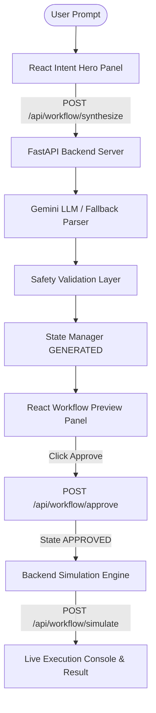

# ⚡ Joss — Intent-Driven Agent Workflow Engine

[](https://reactjs.org/)
[](https://fastapi.tiangolo.com/)
[](https://ai.google.dev/)
[](LICENSE)

**Joss** is a modern, intent-driven automation platform that transforms natural language user requests into structured, verifiable agent workflows. 

Users can describe what they want to accomplish in plain English (e.g. *"Create the assignment for class 10 students and notify the students tomorrow in a Telegram group"* or *"Extract student marks from Excel, calculate grades, and generate report cards"*). Joss synthesizes a multi-step agent pipeline, enforces a **Mandatory Human Approval Gate**, and executes safe step-by-step simulations.

---

## 🌟 Key Capabilities

- 🧠 **Gemini LLM Intent Parser**: Translates natural language prompts into a predictable JSON workflow schema containing intent metadata, parameters, step nodes, and user-facing explanations.
- 🛡️ **Backend Safety Validation Layer**: Inspects synthesized workflows, verifies required parameters (`audience`, `channel`, `schedule`), enforces human consent gates, and blocks unverified auto-executions.
- 🎯 **Supported Intent Guardrails**: Built-in support for:
  - 🎓 **Assignment & Homework Creation**
  - ⏰ **Event & Task Reminders**
  - 📢 **Broadcast Notifications** (Telegram, Slack, WhatsApp, Email)
  - 📋 **Task Checklists & Management**
  *Out-of-scope requests are safely flagged with clear, helpful explanations.*
- 🚦 **State Lifecycle Management**: Keeps state transitions strictly separate (`GENERATED` &rarr; `APPROVED` / `REJECTED` &rarr; `SIMULATED`).
- 🧪 **Backend Simulation Engine**: Safe execution sandbox that runs each step sequentially without invoking real external APIs or sending unauthorized messages.
- 📜 **Student Report Card Synthesizer**: Built-in assessment preview tool with custom school template rendering, grade calculation, and Excel (`.xlsx` / `.csv`) sheet importing.

---

## 🏗️ Architecture & Tech Stack



### Stack Overview
- **Frontend**: React 18, Vite, Vanilla CSS (Glassmorphism dark UI), Lucide Icons, Canvas-Confetti, SheetJS (`xlsx`).
- **Backend**: Python 3.10+, FastAPI, Uvicorn, Pydantic v2, Google GenAI SDK (`google-genai`), Python-Dotenv.

---

## 📁 Repository Structure

```text
HHGOA_TASK_5_PROJECT/
├── backend/
│   ├── routes/
│   │   └── workflow.py          # FastAPI endpoint routes (synthesize, approve, reject, simulate)
│   ├── services/
│   │   ├── llm_service.py       # Gemini API client & fallback parser
│   │   ├── validator.py         # Safety validation layer & guardrails
│   │   ├── state_manager.py     # In-memory workflow state lifecycle repository
│   │   └── simulation_engine.py # Sandbox step simulation runner
│   ├── models.py                # Pydantic schemas for workflows & simulation
│   ├── main.py                  # FastAPI application entrypoint & CORS middleware
│   └── requirements.txt         # Python dependencies
├── src/
│   ├── components/
│   │   ├── Header.jsx           # App header & status indicators
│   │   ├── IntentInputPanel.jsx # Hero prompt bar & preset pills
│   │   ├── WorkflowPreviewPanel.jsx # Step breakdown & approval gate
│   │   ├── WorkflowCanvas.jsx   # Visual interactive node graph
│   │   ├── DataPreviewPanel.jsx # Excel marks table & upload interface
│   │   ├── ReportCardPreviewModal.jsx # School PDF report card viewer
│   │   ├── ExecutionConsole.jsx # Terminal log stream & result card
│   │   └── NodeEditModal.jsx    # Step parameter inspector
│   ├── data/
│   │   └── presets.js           # Demo workflow presets & datasets
│   ├── services/
│   │   └── api.js               # Frontend API client connecting to FastAPI
│   ├── utils/
│   │   └── intentParser.js      # Client-side fallback parser
│   ├── App.jsx                  # Main state orchestrator
│   └── index.css                # Glassmorphic CSS design system
├── .env.example                 # Environment configuration template
├── package.json                 # React dependencies
├── vite.config.js               # Vite build configuration
└── README.md                    # Project documentation
```

---

## 🚀 Quick Start Guide

### Prerequisites
- **Node.js**: v18+ and `npm`
- **Python**: v3.10+ and `pip`

---

### 1. Clone the Repository
```bash
git clone https://github.com/Garv-m-netizen/JOSS---Intent-based-agent-workflows.git
cd JOSS---Intent-based-agent-workflows
```

---

### 2. Configure Environment Variables
Copy `.env.example` to `.env` in the root directory:
```bash
cp .env.example .env
```
Open `.env` and add your **Gemini API Key**:
```env
GEMINI_API_KEY=your_actual_gemini_api_key_here
PORT=8000
ENVIRONMENT=development
```
*(Note: If no API key is provided, Joss will automatically use its built-in LLM schema fallback engine so you can still test everything!)*

---

### 3. Start the FastAPI Backend Server
Install Python dependencies and start the backend:
```bash
pip install -r backend/requirements.txt
python -m uvicorn backend.main:app --port 8000 --reload
```
The FastAPI backend will start running on **`http://localhost:8000`**. You can inspect the interactive OpenAPI documentation at **`http://localhost:8000/docs`**.

---

### 4. Start the React Frontend Server
In a new terminal window, install npm packages and start Vite:
```bash
npm install
npm run dev
```
Open your browser and navigate to **`http://localhost:5173`**.

---

## 🔌 API Endpoints Reference

| Method | Endpoint | Description |
| :--- | :--- | :--- |
| `POST` | `/api/workflow/synthesize` | Accepts plain English prompt, calls Gemini LLM, runs safety validation, and returns structured workflow JSON (`status: GENERATED`). |
| `POST` | `/api/workflow/approve` | Explicitly approves a workflow by `workflow_id` (`status: APPROVED`). |
| `POST` | `/api/workflow/reject` | Cancels/rejects a workflow by `workflow_id` (`status: REJECTED`). |
| `POST` | `/api/workflow/simulate` | Executes step-by-step simulation for an `APPROVED` workflow and returns execution logs. |
| `GET` | `/api/workflow/{workflow_id}` | Retrieves workflow state & metadata. |

---

## 💡 Example Automation Intents to Try

- **Class Assignment Dispatch**:
  > *"Create the assignment for class 10 students and notify the students tomorrow in a particular Telegram group or in their chat group"*
- **Student Report Card Automation**:
  > *"Take students' marks from the Class 10 Excel sheet, calculate totals & letter grades, populate report card templates, and email parents"*
- **Event Reminder**:
  > *"Schedule a reminder for the upcoming Science Olympiad workshop and send an alert to all registered students on WhatsApp"*
- **Sales Lead Qualifying**:
  > *"Import incoming leads from CSV, filter leads with budget > $5000, draft personalized email outreach, and notify team on Slack"*

---

## 📄 License

Distributed under the **MIT License**. See `LICENSE` for more information.
